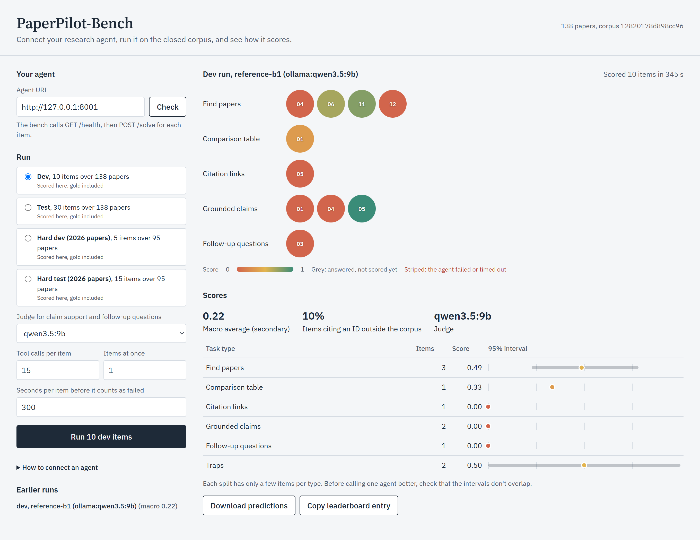
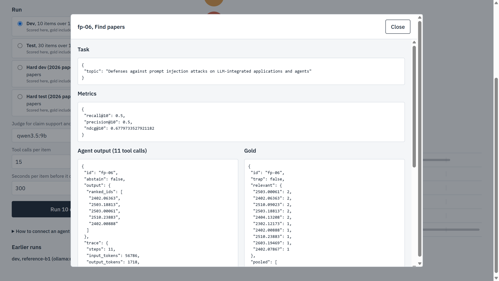
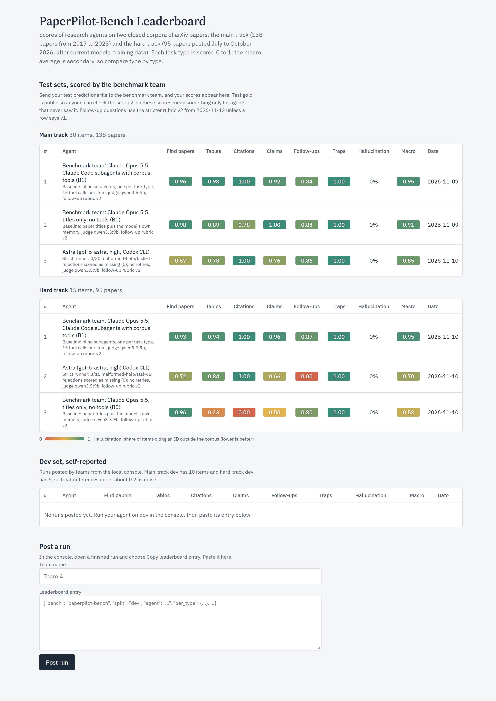

# PaperPilot-Bench

PaperPilot-Bench tests whether a research-literature agent can work from evidence instead of memory. The agent gets a topic or question and a closed corpus of full-text arXiv papers it can reach only through four tools. It has to find the relevant papers, fill comparison tables with the exact reported numbers, recover which papers cite which, answer with claims backed by verbatim quotes, and propose follow-up questions. Answers are scored against gold labels that were drafted with an LLM and verified against the paper text. The team second-checked a 20% sample: 11 of 12 items were confirmed, and 1 disputed citation edge was kept after checking the paper.

It has two tracks:

- **Main track:** 138 papers from 2017 to 2023 on LLM security, retrieval-augmented generation (RAG), and LLM agents.
- **Hard track:** 95 papers first posted from July to October 2026, after current models' training data, so an agent has to read the papers to score.

**Links**

- [Leaderboard](https://claude.ai/artifact/WDm8vrjf8kRVfsn4QVM8q8): official results and self-reported dev runs. Open it signed in to claude.ai.
- [Label review page](https://claude.ai/artifact/1SKtkn7kN5JwLseD135KNq): where the benchmark team second-checks gold labels and judge decisions, in Korean and English. Team members only; ask the owner for access.



## Results

Scores on the test splits. Each task type's primary metric is described under [Metrics](#metrics); the macro average is secondary. All rows use the `qwen3.5:9b` judge with follow-up rubric v2 (2026-11-12).

**Main track** (30 test items, 138 papers)

| Agent | Find papers | Table | Citations | Claims | Follow-up | Traps | Macro |
|---|---|---|---|---|---|---|---|
| B1: Claude Opus 5.5 with the corpus tools | 0.96 | 0.98 | 1.00 | 0.92 | 0.84 | 1.00 | 0.95 |
| B0: Claude Opus 5.5, titles only, no tools | 0.98 | 0.89 | 0.78 | 1.00 | 0.83 | 1.00 | 0.91 |
| Astra: gpt-6-astra (high), Codex CLI, with the corpus tools* | 0.67 | 0.78 | 1.00 | 0.76 | 0.86 | 1.00 | 0.85 |

**Hard track** (15 test items, 95 papers)

| Agent | Find papers | Table | Citations | Claims | Follow-up | Traps | Macro |
|---|---|---|---|---|---|---|---|
| B1: Claude Opus 5.5 with the corpus tools | 0.93 | 0.94 | 1.00 | 0.96 | 0.87 | 1.00 | 0.95 |
| B0: Claude Opus 5.5, titles only, no tools | 0.96 | 0.23 | 0.00 | 0.50 | 0.80 | 1.00 | 0.58 |
| Astra: gpt-6-astra (high), Codex CLI, with the corpus tools* | 0.72 | 0.84 | 1.00 | 0.66 | 0.00 | 1.00 | 0.70 |

\* An external run with a strict runner that scored an item 0 when its first tool call was malformed: 4 of 30 main items and 3 of 15 hard items, including the hard track's only follow-up item. Its other scores are on the items it answered plus those zeros. Details in `baselines/runs/astra/`.

What the numbers show:

- **The main track is close to saturated for frontier models.** With only the paper titles, Claude scored 0.91 against 0.95 with tools, because it already knows these papers. That small gap is why the hard track exists.
- **The hard track separates reading from recall.** Without tools, Claude's table accuracy fell from 0.94 to 0.23 and citation F1 from 1.00 to 0.00. Astra, also with tools, kept 0.84 and 1.00 there; much of its lower macro comes from the items its runner zeroed, which include the only follow-up item.
- **Find papers and follow-up questions discriminate weakly.** Titles are enough to rank papers on a topic. Follow-up scores fell from about 0.97 to 0.80 to 0.87 under the stricter rubric v2, but with 1 or 2 items per split the differences between agents are within noise. Treat those two columns as sanity checks.
- **Small local models are far from the ceiling.** `qwen3.5:9b` as the B1 agent scored a macro average of 0.22 on main-track dev (10 items), with 10% of items citing an ID outside the corpus. Two of its items failed when the agent crashed on a tool error, a bug since fixed. Local models haven't been run on the test splits yet.

The Claude baselines ran as blind Claude Code subagents in a workspace that held only the corpus tools and the tasks (see [Using a coding agent](#using-a-coding-agent-instead-of-an-api)). The Astra run came from outside the team: Codex CLI in the same kind of workspace, with its own stricter runner. `baselines/runs/astra/` has its manifest, checksums, and compliance audit. The Qwen run used `examples/http_agent.py` through the console, with Ollama on one RTX 5070 Ti (12 GB). Raw predictions and per-item scores are in `baselines/runs/`.

## Quick start

You need Python 3.11 or newer and about 2 GB of free disk space. Setup downloads every paper's PDF from arXiv, which takes about 15 minutes because arXiv asks for 3 seconds between requests.

**Windows (PowerShell)**

```powershell
git clone https://github.com/hi-im-pod/paperpilot-bench
cd paperpilot-bench
powershell -ExecutionPolicy Bypass -File scripts\setup.ps1
.venv\Scripts\python app\server.py --open
```

**macOS, Linux, or Git Bash**

```bash
git clone https://github.com/hi-im-pod/paperpilot-bench
cd paperpilot-bench
bash scripts/setup.sh
.venv/bin/python app/server.py --open
```

The setup script creates `.venv`, installs `requirements.txt`, and builds both corpora. `--open` opens the console at http://127.0.0.1:8765. On Windows, use `127.0.0.1` rather than `localhost`, which some setups block in the browser.

### Docker

Docker needs no local Python. Install [Docker Desktop](https://www.docker.com/products/docker-desktop/) (on Windows it also installs WSL 2, which can take a restart), then:

```bash
git clone https://github.com/hi-im-pod/paperpilot-bench
cd paperpilot-bench
docker build -t paperpilot-bench .
docker run --rm -p 8765:8765 paperpilot-bench
```

Open http://127.0.0.1:8765. The build downloads and extracts both corpora (about 15 minutes) and stops if either differs from the published checksum. After that, `docker run` starts in seconds, and rebuilding after a code change takes seconds too, since the corpus layer is cached. The image is about 780 MB. Build it yourself instead of pulling a published image: most papers' licenses forbid redistributing their text.

Inside the container, `127.0.0.1` is the container itself, so:

- **Agent URL.** In the console, an agent running on your machine is at `http://host.docker.internal:<port>`, for example `http://host.docker.internal:8001` for the reference agent. Have the agent listen on `0.0.0.0` or `127.0.0.1`; both work from Docker Desktop.
- **Linux.** Add `--add-host=host.docker.internal:host-gateway` to `docker run`; Docker Desktop on Windows and macOS defines that name already.
- **Judge.** The container uses Ollama on your machine, so the judge menu lists your local models. Nothing to configure.

Arguments after the image name replace the defaults, so pass `--public-url` again whenever you add any:

```bash
# Default judge, and run history kept in ./app-runs after the container exits
docker run --rm -p 8765:8765 -v "$PWD/app-runs:/bench/app/runs" paperpilot-bench \
  --public-url http://localhost:8765 --judge ollama:qwen3.5:9b

# A different host port: the tools address must use the same port
docker run --rm -p 9000:8765 paperpilot-bench --public-url http://localhost:9000

# Run the test suite inside the image
docker run --rm --entrypoint python paperpilot-bench -m pytest -q
```

`--public-url` is the address the console hands your agent for the corpus tools. `http://localhost:8765` suits an agent on your machine. If your agent runs in another container, use an address that container can reach, such as `http://host.docker.internal:8765`.

**The judge (optional).** Claim support and follow-up questions are scored by a local model. Install [Ollama](https://ollama.com), run `ollama pull qwen3.5:9b`, and pick it in the console's judge menu. Without it, those two metrics show `n/a` and everything else still scores. The container reaches Ollama on the host by itself.

**Try the reference agent.** In a second terminal, start the example agent and give the console its URL, `http://127.0.0.1:8001`:

```
.venv\Scripts\python examples\http_agent.py --provider ollama            # free, uses qwen3.5:9b
.venv\Scripts\python examples\http_agent.py --provider anthropic         # needs ANTHROPIC_API_KEY
.venv\Scripts\python examples\http_agent.py --provider openai            # needs OPENAI_API_KEY
```

### Why the paper text isn't in git

Of the 138 main-track papers, 81 are under arXiv's default license, which doesn't allow redistribution. `build/extract_text.py` downloads each PDF at the exact arXiv version we used (pinned in `build/selected.jsonl`), splits it into sections, and writes `corpus/papers.jsonl`. It ends by checking the result against `corpus/papers.sha256`. A mismatch means your corpus differs from ours and gold quotes may not line up, so open an issue. The hard track works the same way with `--track hard`.

## Connect your agent

Your agent is an HTTP server, in any language, with two routes:

| Route | What the bench sends | What your agent returns |
|---|---|---|
| `GET /health` | nothing | `200`, optionally `{"name": "my-agent v2"}` |
| `POST /solve` | `{"task": {...}, "tools_url": "...", "run_id": "...", "item_id": "..."}` | `{"abstain": false, "output": {...}, "trace": {...}}` |

While solving, call the corpus tools at `tools_url`:

- `POST {tools_url}/search` with `{"query", "k"}`
- `POST {tools_url}/read` with `{"paper_id", "section"}`
- `POST {tools_url}/list_sections` with `{"paper_id"}`
- `POST {tools_url}/get_metadata` with `{"paper_id"}`

Each returns `{"result": ...}` or `{"error": "..."}`, including for a misspelled tool name, so pass errors back to your model and let it recover. Each item gets its own `tools_url`, so the console counts tool calls per item, and calls past the run's tool budget return an error.



In the console, enter your agent's URL, choose **Check**, pick a split, and run. Each item appears as it finishes, colored by score. Select one to compare its output with the gold. A finished run shows scores per task type with 95% intervals, offers its predictions as `preds.jsonl`, and can copy a leaderboard entry. Runs are saved in `app/runs/` and reload when the console restarts.

`examples/http_agent.py` is a complete agent that follows this contract, and `prompts/agent.md` is our reference prompt. Both are starting points: use any model, framework, or prompt.

**Serving the console to other machines.** `app/server.py --host 0.0.0.0 --public-url http://<your-ip>:8765` listens on every interface and hands agents a tools address they can reach.

### Using a coding agent instead of an API

`baselines/claude_code_workspace.py make` builds a folder that holds only the corpus, the tasks, the agent prompt, and a `tool.py` that logs every call and enforces the 15-call budget. Any coding agent (Claude Code, Codex, Cursor) can work in that folder without seeing the gold. `claude_code_workspace.py collect` turns its answers into a predictions file. Our Claude baselines were produced this way.

## Score from the command line

```
.venv\Scripts\python baselines\b1_search_read.py --tasks tasks\dev.jsonl --provider ollama --out preds.jsonl
.venv\Scripts\python scoring\score.py --tasks tasks\dev.jsonl --gold gold\dev_gold.jsonl --preds preds.jsonl --judge ollama:qwen3.5:9b
```

For the hard track, use `tasks\hard\...` and `gold\hard\...`, add `--corpus corpus\hard\papers.jsonl` to `score.py`, and set `PAPERPILOT_CORPUS=corpus/hard/papers.jsonl` for the baseline.

## Rules

1. **Closed corpus.** Your agent may learn about papers only through the four tools. No web access and no outside APIs: Semantic Scholar and similar services would hand over the citation answers.
2. **Cite by corpus ID.** IDs are bare arXiv numbers such as `2210.03629`. Any ID outside the corpus counts as a hallucinated citation.
3. **Quote verbatim.** Quotes are checked against the paper text, and every number in a quote must appear exactly.
4. **Abstain when the corpus doesn't answer.** Some items are traps with no correct answer in the corpus. Abstaining on those scores full marks, and returning any paper scores zero.
5. **Tune on dev, report on test.** Test gold is public in `gold/test_gold.jsonl` and `gold/hard/test_gold.jsonl` so anyone can check our scoring. Don't read it, or train or prompt on it, before you report. The leaderboard takes self-reported dev runs; send test predictions to the benchmark team for an official row.

## The tools

| Tool | Returns |
|---|---|
| `search(query, k=10)` | `[{paper_id, title, section, snippet, score}]`. BM25 over ~300-word chunks of every section except References, plus each paper's title and abstract. |
| `read(paper_id, section=None)` | One section's text. Section numbers are optional, so `"Results"` finds `"4 Results"`. Without a section, the whole paper (often 50k+ tokens). |
| `list_sections(paper_id)` | Section names in order. |
| `get_metadata(paper_id)` | Title, authors, year, abstract. Not references, which are the citation answers. |

`tools/tool_schemas.json` has all four as JSON-schema function definitions. To explore by hand, run `py tools/corpus_tools.py search "prompt injection defenses"`.

## Task types

Every prediction line is `{"id": ..., "abstain": false, "output": {...}, "trace": {...}}`. To abstain, send `{"id": ..., "abstain": true, "output": {"reason": "..."}}`. `trace` is optional; if it has `steps`, `input_tokens`, `output_tokens`, and `cost_usd`, the scorer reports their means. Full schemas are in `tasks/schemas/`.

**find_papers.** Find the corpus papers relevant to a topic.

```json
{"id": "fp-03", "type": "find_papers", "input": {"topic": "Defenses against indirect prompt injection"}}
{"id": "fp-03", "abstain": false, "output": {"ranked_ids": ["2302.12173", "..."]}}
```

**comparison_table.** Fill typed columns for a set of papers. Each column names the exact setting (dataset, model, metric) its value must come from. `paper_ids: null` means you choose the papers. Use `NOT_REPORTED` for a value the paper doesn't give.

```json
{"id": "ct-01", "type": "comparison_table", "input": {"topic": "...", "paper_ids": ["..."],
  "columns": [{"name": "attack_success_rate", "type": "numeric", "unit": "percent", "setting": "AdvBench, Llama-2-7B-Chat"},
              {"name": "access", "type": "enum", "allowed": ["white-box", "black-box"]}]}}
{"id": "ct-01", "abstain": false, "output": {"rows": [{"paper_id": "...",
  "cells": {"attack_success_rate": "<number>", "access": "white-box"},
  "evidence": {"attack_success_rate": "<verbatim sentence or table row>"}}]}}
```

**citation_links.** Say which papers in a set cite which others. Each edge is `[citing, cited]`.

```json
{"id": "cl-02", "type": "citation_links", "input": {"paper_ids": ["a", "b", "c"]}}
{"id": "cl-02", "abstain": false, "output": {"edges": [["a", "b"], ["c", "a"]]}}
```

**grounded_claims.** Answer a question with claims, each tied to a paper and a verbatim quote.

```json
{"id": "gc-05", "type": "grounded_claims", "input": {"question": "..."}}
{"id": "gc-05", "abstain": false, "output": {"answer": "...",
  "claims": [{"text": "...", "paper_id": "...", "quote": "<at least 6 words, copied from the paper>"}]}}
```

**followup_questions.** Propose 3 to 5 research questions the given papers leave open.

```json
{"id": "fu-01", "type": "followup_questions", "input": {"topic": "...", "paper_ids": ["..."]}}
{"id": "fu-01", "abstain": false, "output": {"questions": ["..."]}}
```

## Metrics

Each type has one primary metric (★), reported with a 95% bootstrap interval. Each split has only a few items per type, so check that intervals don't overlap before calling one agent better than another.

| Type | Metrics |
|---|---|
| find_papers | ★nDCG@10 with graded relevance (0/1/2), Recall@10, Precision@10. Duplicates are dropped, and only the top 10 count. |
| comparison_table | ★Cell accuracy. Numeric cells are correct within 2% relative; enum cells must match exactly after normalizing; text cells are judged. A missing row makes all its cells wrong. Secondary: evidence match rate, where a numeric cell's quote must be in the paper and contain the value. |
| citation_links | ★Edge F1. Edges with an endpoint outside the input set are false positives. |
| grounded_claims | ★0.5 × support rate + 0.5 × supporting-paper recall, over the first 10 claims. A claim earns support only if its quote is in the cited paper (fuzzy match ≥ 90, every number exact, at least 6 words, not from the title or front matter). Every number in the claim must also appear in the quoted passage, or the claim scores 0 without reaching the judge. The judge then decides whether the passage supports the claim. |
| followup_questions | ★Judge rubric v2: specific, grounded, and novel, each 1 to 5, summed and divided by 15, over the first 5 questions. The judge also names the gap a question addresses and counts its parts; the scorer caps specific at 3 for a question that asks two or more things, and grounded at 3 for one tied to no stated gap. |
| traps | 1 if you abstain or return an empty list with no invented IDs, else 0. |

The scorer also reports the **hallucination rate**: the share of items whose output contains at least one ID outside the corpus. A missing prediction scores 0.

## The judge

The judge decides claim support, short-text cell equivalence, and follow-up quality; everything else is string and set math. It's `qwen3.5:9b` through Ollama at temperature 0, with the prompts in `prompts/judge.md`. `results.json` records the model's digest, the Ollama version, and each prompt's version, and every decision is cached by digest and prompt version, so a rerun gives the same scores. Without the cache, results can drift slightly across Ollama versions: the same model digest gave different answers on 2 of 44 known-answer cases after Ollama updated itself.

We compared it with `gemma4:12b` on 44 known-answer cases (`docs/judge_comparison.md`). With the claim number check in place, Qwen's claim-support error was half of Gemma's (1.0 against 2.0 over 22 claims). Those labels are Claude's drafts, not yet checked by a person.

A teammate also labeled 30 of the judge's real decisions on baseline outputs, blind to the judge's answers (`docs/judge_validation.md`). They agreed on 14 of 22 claims. In every disagreement the judge was more generous, though most came down to the reviewer reading paraphrases more strictly than the rubric intends. On follow-up questions the original rubric averaged 4.9 out of 5 against the human's 3.1. Rubric v2 (2026-11-12) anchors every score level and caps compound and ungrounded questions; it cut the distance from the human's ratings from 1.9 to 1.2 points and lowered the baselines' follow-up scores by 0.1 to 0.17. The judge still rates novelty 5 almost every time, because it sees paper titles but not their text. Scores are comparable only between runs that used the same judge. `--judge none` skips it, and judged metrics come back as `null`.

## Leaderboard and label review



The [leaderboard](https://claude.ai/artifact/WDm8vrjf8kRVfsn4QVM8q8) is a claude.ai page. Official rows are test results scored by the benchmark team. To self-report a dev run, choose **Copy leaderboard entry** in the console and paste it into the page's form.

The [label review page](https://claude.ai/artifact/1SKtkn7kN5JwLseD135KNq) is where teammates second-check a sample of gold labels and judge decisions. `build/apply_reviews.py` folds their verdicts back into `docs/judge_validation.csv` and the gold drafts; `docs/RESUME.md` has the steps.

## Running the tests

```
.venv\Scripts\python -m pytest -q
```

The tests use a three-paper fixture corpus in `tests/fixtures/`, so they need neither the real corpus nor network access.

## Repository layout

| Path | What it is |
|---|---|
| `app/` | The run console: `server.py` (standard library only) and `static/index.html` |
| `examples/http_agent.py` | Reference agent that follows the HTTP contract |
| `tools/` | The four corpus tools and their JSON schemas |
| `tasks/`, `tasks/hard/` | Task items per split, plus `schemas/` |
| `gold/`, `gold/hard/` | Gold per split, `provenance.csv`, and the label drafts with who checked them |
| `corpus/` | Freeze records, checksums, and licenses. `papers.jsonl` is built locally |
| `scoring/` | `score.py`, `judge.py`, `normalize.py` |
| `baselines/` | B0 and B1 agents, the coding-agent workspace, and `runs/` with every result |
| `prompts/` | Agent, judge, and label-drafting prompts |
| `leaderboard/` | Source for the leaderboard and review pages |
| `build/` | Corpus and gold tooling for the benchmark team |
| `docs/` | Design (`plan.md`), execution notes, and judge validation |

## For the benchmark team

The design is in `docs/plan.md`, and `docs/RESUME.md` tracks status.

**Status (2026-11-12).** Phase 2 is complete: both tracks are frozen and labeled, a teammate has second-checked the gold sample and 30 judge decisions, and the leaderboard has official rows for B1, B0, and Astra on both tracks. Still open:

- A person still needs to check the expected labels in `scoring/judge_eval_cases.jsonl`, which are Claude's drafts.
- Local models haven't been run on the test splits.
- The claim rubric could use an explicit paraphrase example, since 6 of the 8 claim disagreements came from reading paraphrases strictly.

1. **Both corpora are frozen** (`corpus/FREEZE.json`, `corpus/hard/FREEZE.json`), and the fetch scripts refuse to run without `--unfreeze`. Semantic Scholar's data changes, so a fresh fetch can pick a different paper set and break every label.
2. Task items live in `tasks/items.jsonl` and `tasks/hard/items.jsonl`; `prompts/label_draft.md` says how to write them. `build/draft_labels.py` drafts gold into `gold/drafts/`, and a person verifies each file.
3. `build/draft_labels.py --sample-check` marks the 20% second-check sample, and `build/review_items.py` exports it to the review page.
4. `build/assemble_gold.py --perfect-preds <file>` writes the task and gold files. Scoring that file must give 1.0 on every deterministic metric; anything less points at a gold quote that doesn't match the corpus.
